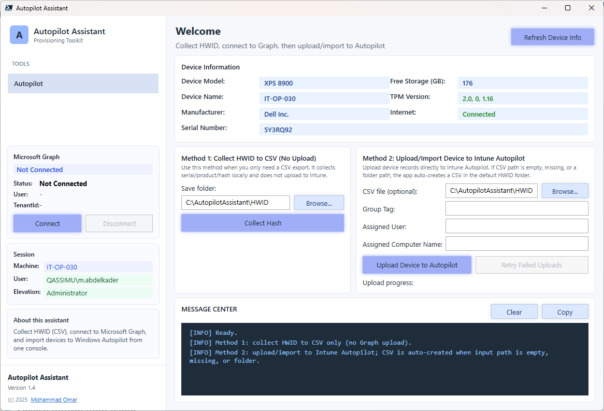

<div align="center">

# 🚀 Autopilot Assistant

**Windows Autopilot onboarding, simplified**

Collect hardware hashes, import devices into Intune Autopilot, and monitor every upload — from one clean WPF interface.


[Features](#-core-features) • [Usage](#-usage) • [Requirements](#️-requirements) • [Troubleshooting](#-troubleshooting)

</div>

---

# 📖 Overview

**Autopilot Assistant** is a modern WPF-based PowerShell tool designed to simplify **Windows Autopilot onboarding** and device provisioning workflows. It provides a structured, production-ready interface for:

* Collecting the **Hardware Hash (HWID)**
* Connecting securely to **Microsoft Graph** (interactive delegated auth)
* Importing devices into **Intune Autopilot**
* Preventing duplicate uploads automatically
* Monitoring upload status with structured results
* Logging all operations locally

---

## 🖼️ Screenshots



*Main window: live device information panel, the two collection/upload methods, and the real-time Message Center.*

---

# ✨ Core Features

### 🔹 Device Information Panel
* Device model, name, manufacturer, serial number
* Free storage (GB) and TPM version
* Internet connectivity status
* Session details (machine / user / elevation)

### 🔹 Method 1 — Collect HWID (No Upload)
* Exports a compliant Autopilot CSV
* Does **not** require a Graph connection — ideal for offline preparation

```csv
Device Serial Number,Windows Product ID,Hardware Hash
"ABC12345","00330-80000-00000-AAOEM","<base64HWID>"
```

### 🔹 Method 2 — Upload to Intune Autopilot
* Connect to Microsoft Graph (browser interactive)
* Upload from CSV, JSON, or auto-generate a single-device CSV
* Optional: Group Tag, Assigned User (UPN), Assigned Computer Name
* Built-in duplicate detection by serial number
* Automatic status polling (Complete / Queued / Failed)

### 🔹 Upload Result Engine
After upload, a structured results window shows:

| Status | Meaning |
|---|---|
| ✅ Success | Imported into Autopilot |
| ⏳ Queued | Import pending in Intune |
| ⚠ Duplicate (Skipped) | Serial already registered |
| ❌ Failed | Import error — retry available |

With summary counts: `Total | Success | Failed | Duplicate | Queued`

### 🔹 Retry Engine
* Automatically tracks failed rows
* **"Retry Failed Uploads"** re-submits only failed records — successful entries are never reprocessed

### 🔹 Message Center
Real-time log console with levels: INFO, SUCCESS, WARN, ERROR. Logs also written to:

```text
C:\AutopilotAssistant\Logs\app_YYYYMMDD.log
```

---

# 🚀 Usage

### Launch

**Option 1 — PowerShell script:**

```powershell
Set-ExecutionPolicy Bypass -Scope Process -Force
.\Autopilot Assistant.ps1
```

**Option 2 — Packaged EXE (self-signed with PSWrap):**

```text
Autopilot Assistant.exe
```

The `.exe` was compiled and self-signed using [PSWrap](https://github.com/mabdulkadr/PSWrap) — no PowerShell console required.

### Typical Workflow

1. Launch the tool **as Administrator**
2. Review the device information panel
3. Click **Connect** (Microsoft Graph)
4. Choose the upload method — provide a CSV, or leave the path empty to auto-create one
5. Click **Upload Device to Autopilot**
6. Review the results window; retry any failures

### Supported Input Formats

```csv
Device Serial Number,Windows Product ID,Hardware Hash
"PF12345","00330-80000-00000-AAOEM","<base64HWID>"
```

---

# ⚙️ Requirements

| Requirement | Details |
|-------------|---------|
| **OS** | Windows 10 / 11 |
| **PowerShell** | Windows PowerShell 5.1 |
| **Elevation** | Run as **Administrator** (required for HWID collection) |
| **Modules** | `Microsoft.Graph.Authentication` + `MSAL.PS` (auto-checked) |
| **Graph permissions** | Delegated: `User.Read`, `Device.Read.All`, `DeviceManagementServiceConfig.ReadWrite.All` |

Install the modules once per system:

```powershell
Install-Module Microsoft.Graph.Authentication -Scope AllUsers -Force
Install-Module MSAL.PS -Scope AllUsers -Force
```

The signing-in user must have sufficient Intune permissions.

### Data & Logs

```text
C:\AutopilotAssistant\
├── HWID\        # exported Autopilot CSV files
└── Logs\        # daily application logs
```

No data is stored outside this root path.

---

# 🔍 Troubleshooting

| Symptom | Likely Cause | Fix |
|---------|--------------|-----|
| HWID collection fails | Not running as Administrator | Right-click → Run as Administrator |
| Graph connect fails | No internet or proxy blocking | Check network/proxy settings |
| Module not found error | MSAL.PS or Graph module missing | Run the `Install-Module` commands above |
| Upload shows "Duplicate" | Serial already exists in Autopilot | Check existing devices, or use Retry Failed |
| UI freezes during upload | Rare; background job issue | Restart the tool |

---

# 🛡 Operational Notes

* **Built-in pre-checks** — admin rights, internet connectivity, Graph module presence, and serial-duplicate detection run before every upload
* **Least-privilege auth** — delegated Graph scopes only; no device-code flows, no app-only secrets to manage
* **Token safety** — in-memory token caching, session only; nothing auth-related is persisted to disk
* **Proxy-aware** — Graph connectivity respects system proxy configuration
* **Async by design** — STA RunspacePool + DispatcherTimer keep the UI responsive during uploads
* **Test in staging** — validate Group Tag / Assigned User values against a pilot device before fleet onboarding

---

## 👤 Author

**Mohammad Abdulkader Omar**  
GitHub: [@mabdulkadr](https://github.com/mabdulkadr)  
Website: [momar.tech](https://momar.tech)  

---

## 📜 License

This project is licensed under the [MIT License](LICENSE).

---

## ⚠ Disclaimer

This skill and every script it generates are provided as-is with no warranty
of any kind. Test generated tools in a staging environment before deploying to
production. The authors assume no liability for any damage or data loss
resulting from their use.

---

<div align="center">

⭐ **If this tool saves you time, star the repo — it helps others find it.**

[Report an Issue](../../issues) · [momar.tech](https://momar.tech)

[](https://www.buymeacoffee.com/mabdulkadrx)

Built with [**PowerShell Enterprise Admin**](https://github.com/mabdulkadr/powershell-enterprise-admin-skill)

</div>
